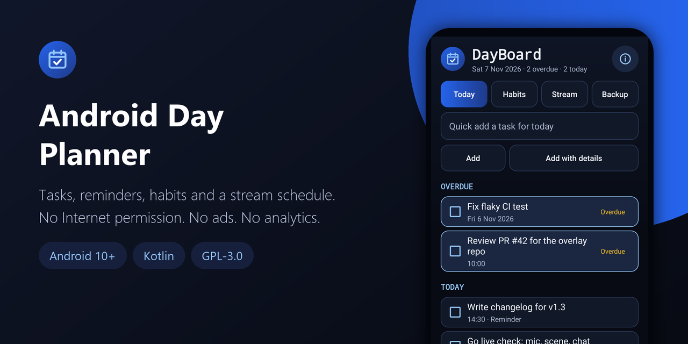
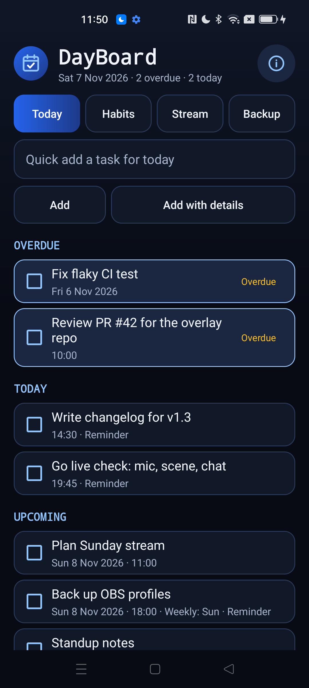
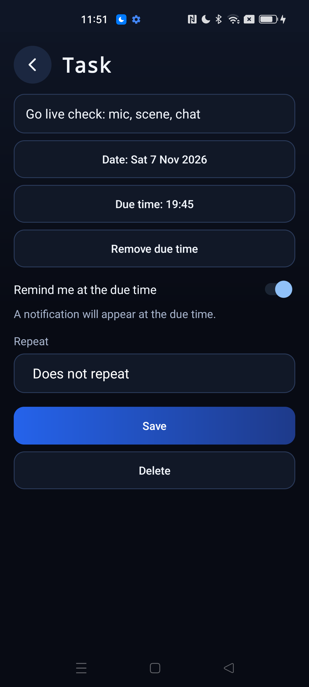
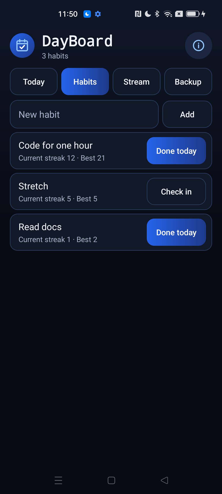
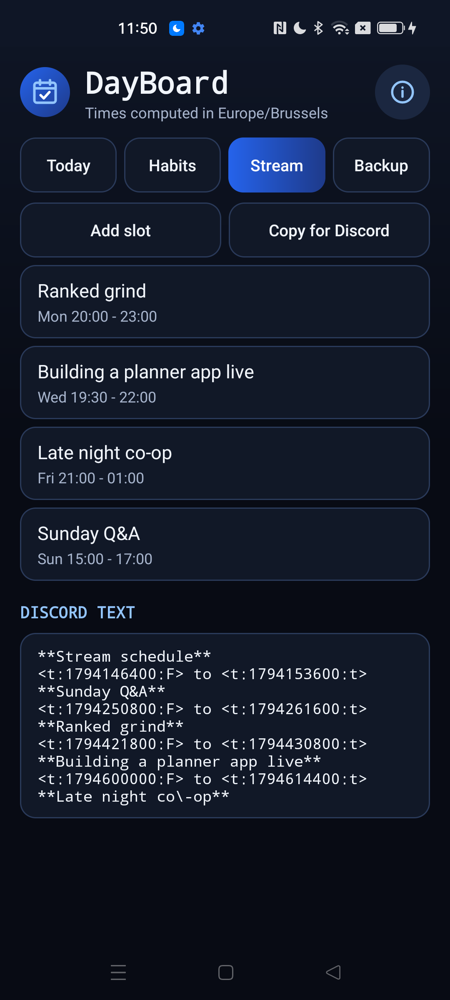
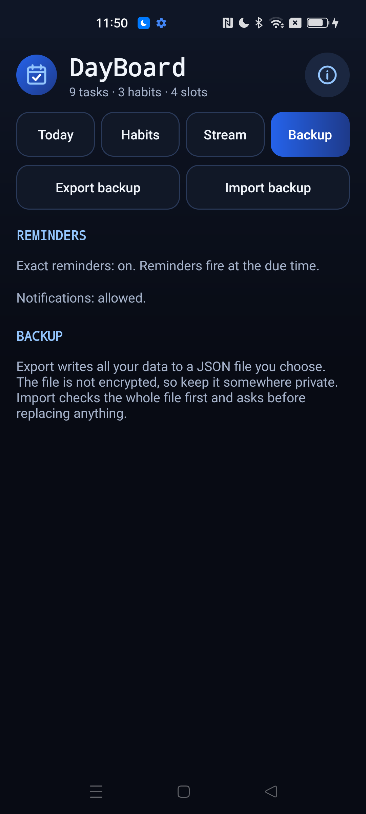

<div align="center">



# Android Day Planner

**A private daily planner for developers who stream: tasks with reminders, repeating tasks, habit streaks and a weekly stream schedule you can paste into Discord. No Internet permission. Open source, no ads, no analytics.**

[](LICENSE)
[](#requirements)
[](https://kotlinlang.org)
[](app/build.gradle.kts)
[](app/src/main/AndroidManifest.xml)
[](https://github.com/Nekuzaky/android-day-planner/stargazers)

</div>

Android Day Planner ships an app called **DayBoard**. It keeps your day in one place: what is due today, what is overdue, the habits you are building and when you go live.

DayBoard has no Internet permission, so your tasks, habits and schedule stay on your phone unless you export them yourself.

## Screenshots

<p align="center">
  
  
  
  
  
</p>

## Features

- **Today:** overdue, today, upcoming and done sections, quick add, check off and undo
- **Tasks:** a date, an optional due time and an optional reminder at that time
- **Repeating tasks:** daily, weekdays, weekly on chosen days, or monthly on a day of the month. A monthly task on the 31st falls on the last day of shorter months and comes back to the 31st after
- **Reminders:** a notification at the due time, restored after a reboot, an app update, a clock change or a time zone change
- **Habits:** one check-in per day, with the current and best streak
- **Stream schedule:** weekly slots with a title, a start and an end. A slot can end after midnight
- **Discord text:** one tap copies the schedule with Discord timestamps (`<t:unix:F>`), so every viewer sees the times in their own time zone
- **Backup:** export and import all your data as a JSON file through the Android file picker
- Every delete asks first. No ads, no analytics, no account and no third-party libraries

## How it works

**Due times are wall-clock times.** A task due at 09:00 stays at 09:00 after a daylight saving change and when you travel to another time zone. A time skipped by a clock change fires right after the gap, and a repeated hour fires only once.

**A reminder fires once per occurrence.** DayBoard remembers the last occurrence it reminded you about. A missed reminder, for example while the phone was off, fires once when the phone is back. A repeating task you have not checked off keeps reminding you at each new occurrence.

**Clock changes are repaired.** If the clock is set to the future and back, reminders that fired under the wrong clock are armed again for their real time.

**Exact or approximate.** Reminders use exact alarms when Android allows them. Without that permission they fall back to approximate alarms, which Android may delay, and the app says so on the Today and Backup tabs.

**Storage.** All data is one JSON file in private app storage. Every save writes a temporary file and renames it, so a crash cannot leave half a file. A damaged file is never overwritten: it is kept aside, the app starts empty and tells you, and you can save a copy of the damaged file or delete it.

## Privacy and security

- No Internet permission, no analytics and no logging.
- No storage permission. Backups are read and written only where you choose with the Android file picker.
- Android backups are off, and `dataExtractionRules` excludes everything from cloud backup and device transfer.
- Only the launcher activity is exported, and it reads nothing from its intent. The editors are not exported.
- The system event receiver is not exported. It acts only on its five system actions and reads nothing else from the intent. The reminder receiver is not exported, uses explicit immutable `PendingIntent`s and carries only a task ID, which is checked against your data.
- Buttons, switches and dialogs ignore touches when another window covers them.

Text from outside the app is treated as hostile input:

- **Imported backups** are limited to 8 MB, checked in full before anything is replaced, and need a confirmation. Unknown fields, duplicate IDs, impossible dates and too many items are refused with a reason, and nothing changes.
- **Titles** have control, bidi, format and invisible characters removed and their length capped.
- **Discord text** escapes Discord markdown and puts a zero-width space after every `@`, so a title cannot ping `@everyone` or `@here`, mention a user or role, add a link, or start a new line.

### Permissions

| Permission | Why it is needed |
| --- | --- |
| `POST_NOTIFICATIONS` | Shows reminders. Asked for when you turn on your first reminder, on Android 13 and later |
| `SCHEDULE_EXACT_ALARM` | Fires reminders at the exact time. Without it, reminders are approximate |
| `RECEIVE_BOOT_COMPLETED` | Restores reminders after the phone restarts |

## Requirements

- Android 10 (API 29) or later
- JDK 21 and Android SDK 35 to build from source

Gradle 8.11 does not support the Java 25 runtime bundled with recent Android Studio versions, so use a separate JDK 21.

## Download

Download the signed APK from the [latest release](https://github.com/Nekuzaky/android-day-planner/releases/latest) and open it on your phone. Android may ask you to allow installs from the app you opened it with.

The release notes list the SHA-256 checksum of the APK and of its signing certificate.

## Build from source

A build signed with your own key cannot install over the release APK, so uninstall the app first. Export a backup before you do.

```bash
git clone https://github.com/Nekuzaky/android-day-planner.git
```

```bash
cd android-day-planner
```

Create a `local.properties` file that points to your Android SDK:

```properties
sdk.dir=/path/to/Android/Sdk
```

Build a debug APK with JDK 21. No signing setup is needed:

```bash
JAVA_HOME=/path/to/jdk-21 ./gradlew assembleDebug
```

Run the unit tests:

```bash
JAVA_HOME=/path/to/jdk-21 ./gradlew testDebugUnitTest
```

Install it on a phone with USB debugging enabled:

```bash
adb install -r --user 0 app/build/outputs/apk/debug/app-debug.apk
```

### Signed release build

Create a signing key, then add a `keystore.properties` file at the project root. It is ignored by Git, so never commit it or your key:

```properties
storeFile=/path/to/your-key.jks
storePassword=your-password
keyAlias=release
keyPassword=your-password
```

```bash
JAVA_HOME=/path/to/jdk-21 ./gradlew assembleRelease
```

Without `keystore.properties` the build still works, and `assembleRelease` produces an unsigned APK.

## Limitations

- **Phone makers can delay alarms.** On the test phone (ColorOS), Android accepted exact alarms but still gave them a delivery window. Reminders fired between on time and about 50 seconds late. Battery savers on other brands may do more.
- **Approximate without the permission.** Without exact alarms, Android may delay a reminder by many minutes.
- **One reminder per task.** The reminder is at the due time. There is no early warning, snooze or second reminder.
- **No yearly repeat and no custom intervals** such as every two weeks.
- **Habits are daily only.** A check-in is for today, so a missed day cannot be filled in later.
- **Turning notifications back on** takes effect the next time you open the app.
- **Discord limits.** Discord allows 2,000 characters per message. The app warns when the text is longer, but it does not split it. How Discord displays the escaped text has not been checked in Discord itself.
- **Backups are not encrypted.** Keep exported files somewhere private.
- **Limits:** 2,000 tasks, 50 habits, 50 stream slots, and about 20 years of check-ins per habit.
- **A clock set to the future** can still advance a repeating task you checked off while the clock was wrong. Only reminders are repaired.
- **Large time zone jumps.** A reminder that fired in one zone does not fire again at the same wall-clock time in another zone.

## Test status

Unit tests for the current source: 316 pass under `testDebugUnitTest`, on the JVM. They cover repeating dates (leap years, February 29, January 31 monthly, year boundaries), reminders across both Europe/Paris daylight saving changes and the America/New_York overlap hour, time zone travel, clock repair, streaks, the Discord text with hostile titles, the JSON parser and backup validation with malformed and hostile files, atomic saves and damaged files, and the manifest.

Tested with a debug build on one phone: Oppo Reno4 Z 5G, Android 12, ColorOS.

| Check | Result |
| --- | --- |
| Add, edit, complete, undo and delete tasks, habits and stream slots | Works. Every delete asked first |
| Reminder at the due time, app in the background | Fired between on time and 49 seconds late, because of the ColorOS alarm window |
| Daily task checked off and undone | Moved to the next day and back, with the alarm moved too |
| Clock set to 2030 and back | Reminders that fired under the 2030 clock fired again at their real time |
| Time zone changed to New York and back | Alarms kept their wall-clock time, and the stream tab followed the zone |
| Day rollover at midnight | The Today screen moved to the new day and updated the overdue count |
| Notifications turned off, reminder time passed, turned back on | Reminder kept, then fired once when the app was opened |
| Exact alarms revoked and granted | Notice shown while revoked. Alarms rescheduled after granting, with the app closed |
| Reboot with a reminder due during the reboot | Alarms restored and the missed reminder fired once after boot |
| Data file from an older build | Kept aside, notice shown, copy saved through the picker, then deleted after a confirmation |
| Export | File identical to the app data |
| Import of truncated, non-UTF-8, 9 MB, deeply nested, unknown-field and duplicate-ID files | Refused with a reason, data unchanged |
| Import of a file with bidi, newline and markup in a title | Confirmation shown and kept through two rotations. The title was cleaned |
| Copy for Discord with a hostile slot title | `@` followed by a zero-width space, markup escaped |
| Rotation and process death in the task editor | Unsaved changes kept |
| 2,000 monkey taps | No crash, no ANR |

Not tested: a stalled import from an offline cloud provider, pasting the text into Discord, Android 10, 11, 13 and later (including the notification permission prompt, which only exists on Android 13 and later), other brands, tablets and work profiles. If something breaks on your phone, please open an issue.

## Related

- [Android App Firewall](https://github.com/Nekuzaky/android-app-firewall): cut Internet access per app.
- [Android Permission Manager](https://github.com/Nekuzaky/android-permission-manager): see what every app can access.
- [Android APK Inspector](https://github.com/Nekuzaky/android-apk-inspector): see how any installed app is built.
- [Android Tracker Detector](https://github.com/Nekuzaky/android-tracker-detector): find tracking code inside your apps.
- [Android Network Monitor](https://github.com/Nekuzaky/android-network-monitor): see the traffic of your apps.

## License

Distributed under the [GNU General Public License v3.0](LICENSE).
